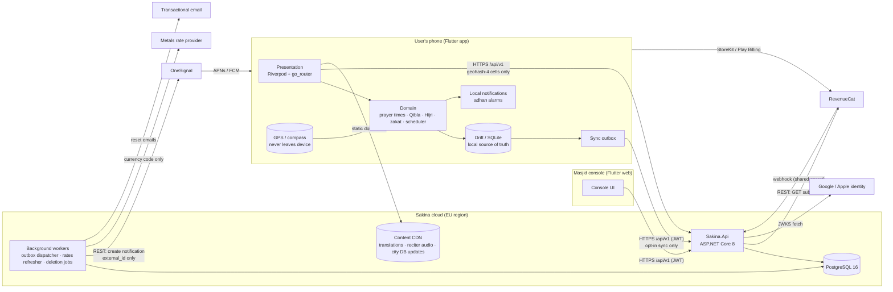
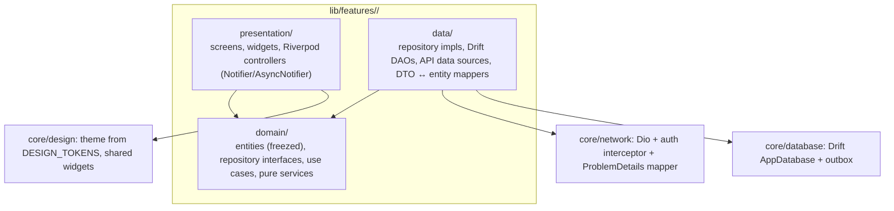
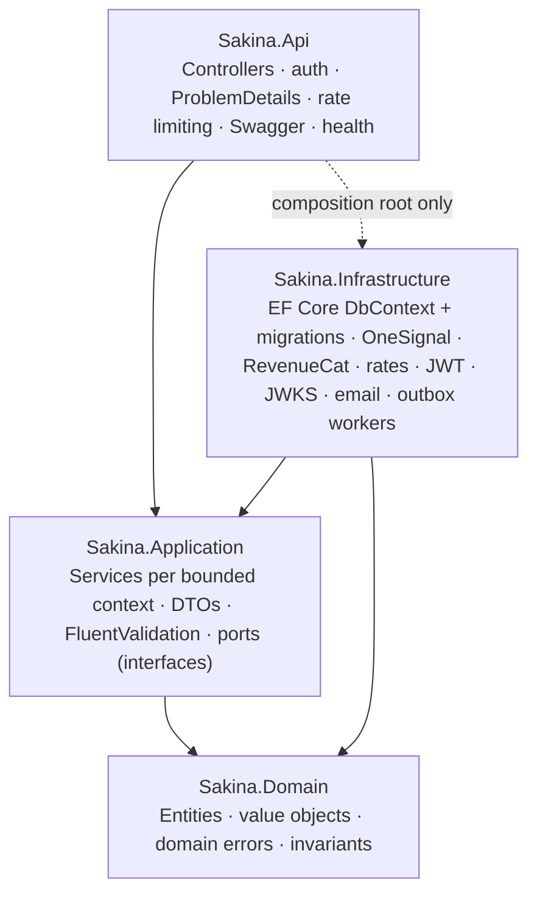

# Sakina: Architecture

| | |
|---|---|
| Status | Accepted for MVP (v1). Changes need an ADR |
| Date | 2026-10-17 |
| Related | `SPEC.md`, `openapi.yaml`, `adr/0001`–`0014` |

## 1. Principles

1. **Worship runs on the device.** Prayer times, adhan scheduling, Qibla, Hijri dates, Ramadan and zakat maths are pure Dart on the phone. The backend holds no feature that worship depends on (ADR-0007).
2. **The server knows only what users chose to share.** Every table is justified by an explicit opt-in (SPEC §6.2).
3. **The contract comes first, and two tracks build to it.** `docs/openapi.yaml` is the only coupling between `apps/mobile` and `apps/backend` (ADR-0011).
4. **Offline first, then sync.** The local database is the source of truth for the UI. The network is an optimisation.
5. **Boring, explicit and testable.** Plain application services (no mediator), constructor injection, pure domain logic, real Postgres in integration tests.

## 2. System context



**What crosses the boundary**

| Flow | Data | Never included |
|---|---|---|
| Device → API | Account credentials, opt-in sync payloads, geohash-4 cells, encouragements, follows | Coordinates, city, timezone, prayer times |
| Device → CDN | Static file GETs (normal HTTP metadata) | Any identifier |
| API/Worker → OneSignal | `external_id` list, notification content / template key + IDs | Email, name, tags, location |
| Device → RevenueCat | App user ID (= Sakina user UUID), purchases | Email, attributes |
| Worker → rates provider | Currency code | Anything about users |

## 3. Mobile architecture (Flutter)

### 3.1 Layers (feature-first clean architecture)

Each feature owns three layers. Dependencies point inward only: presentation → domain ← data.



- **Domain** is pure Dart (no Flutter imports) apart from `package:meta`, so it is unit-testable at full speed. It contains entities, value objects (`PrayerTimeSettings`, `Money`), repository **interfaces**, and services such as `PrayerTimeCalculator`, `AdhanScheduler`, `QiblaCalculator`, `HijriCalendar`, `ZakatCalculator` and `StreakPolicy`.
- **Data** implements the repositories. **Every read goes to Drift first.** Remote data sources are called only by sync jobs and refresh actions, and they write into Drift. The UI watches Drift streams.
- **Presentation** holds Riverpod `Notifier` / `AsyncNotifier` controllers per screen, and widgets that are pure functions of controller state.

### 3.2 Directory layout

```
apps/mobile/
  lib/
    main.dart                    # mobile entrypoint
    main_console.dart            # masjid console (web) entrypoint (ADR-0002)
    app/
      router.dart                # go_router: routes, redirects (onboarding, auth, plus gates)
      bootstrap.dart             # ProviderScope overrides per flavour, error zones
    core/
      design/                    # tokens.dart, theme.dart, typography.dart (from DESIGN_TOKENS.md)
      l10n/                      # generated AppLocalizations; ARB in lib/l10n/
      network/                   # dio_client.dart, auth_interceptor.dart, problem.dart, pinning.dart
      database/                  # app_database.dart (Drift), outbox.dart, migrations/
      auth/                      # session store (flutter_secure_storage), token refresh
      platform/                  # alarm channel, battery/OEM probes (MethodChannel), location, compass
      sync/                      # SyncEngine: outbox dispatcher, pull scheduler, backoff
      result.dart                # sealed Result<T, Failure>
    features/
      onboarding/   {presentation,domain,data}
      today/        # next prayer, daily times, self prayer log, streak
      prayer_times/ # calculator, settings, method catalogue, city DB (shared domain)
      adhan/        # scheduler, health checks, voices, test adhan
      quran/        # reader, audio, bookmarks, memorisation, packs
      family/       # families, members, child profiles, logs grid, encouragements
      ramadan/
      zakat/
      travel/       # arrival detection, Qibla compass
      masjids/      # search, detail, follow
      plus/         # paywall, RevenueCat wrapper, entitlements
      account/      # sign in/up, social, delete
      settings/
      console/      # masjid console screens (web only; shares masjids/data)
  assets/
    quran/          # uthmani.sqlite (bundled), en.sqlite (bundled default translation)
    cities/         # cities.sqlite (~150k cities: name EN/AR/UR, lat, lng, tz, country)
    adhan/          # adhan voices (ogg/caf)
    fonts/          # Fraunces, Manrope, Amiri, Noto Naskh Arabic, Noto Nastaliq Urdu (bundled, OFL)
  test/ {unit,widget,integration,golden,fixtures}
```

### 3.3 Key libraries

| Concern | Choice | Notes |
|---|---|---|
| State / DI | `flutter_riverpod` + `riverpod_generator` | Providers are the DI container. Tests override repositories |
| Navigation | `go_router` | Typed routes. Redirects for onboarding, auth and Plus gates. Deep links `sakina://family/join?code=` |
| Local DB | `drift` (SQLite) | Reactive queries. Schema migrations are tested with `drift_dev` schema dumps |
| HTTP | `dio` | Interceptors for auth refresh, `Accept-Language`, ProblemDetails mapping, cert pinning |
| Models | `freezed` + `json_serializable` | DTOs are generated from, or checked against, `openapi.yaml` fixtures |
| Prayer times | `adhan` (Dart port of adhan-js) | Wrapped behind `PrayerTimeCalculator` so it can be swapped. Vectors in tests |
| Notifications | `flutter_local_notifications` + a custom Android alarm channel | Exact alarms via `zonedSchedule(androidScheduleMode: exactAllowWhileIdle)` |
| Push | `onesignal_flutter` | `login(externalId)`, location sharing off, no tags |
| Purchases | `purchases_flutter` | `appUserID` = Sakina user UUID |
| Secure storage | `flutter_secure_storage` | Tokens only |
| Audio | `just_audio` + `audio_service` | Quran recitation in the background |
| Sensors / location | `geolocator` (while-in-use), `flutter_compass` | Never in the background |
| l10n | `flutter_localizations` + `intl` + `gen-l10n` | ARB files |

Every package must pass the no-phone-home review (CONTRIBUTING §6).

### 3.4 Offline-first data flow and sync

```mermaid
sequenceDiagram
  participant UI as Today/Family UI
  participant Repo as PrayerLogRepository
  participant DB as Drift
  participant OB as Outbox
  participant Sync as SyncEngine
  participant API as /api/v1

  UI->>Repo: logPrayer(member, date, ASR, ON_TIME)
  Repo->>DB: upsert prayer_log (clientUpdatedAt = now)
  Repo->>OB: enqueue PUT /families/{id}/prayer-logs (coalesced by key)
  DB-->>UI: stream emits new state (instant)
  Sync->>OB: drain when online (connectivity + app resume + 15-min periodic)
  Sync->>API: PUT batch (≤200) with Idempotency-Key
  API-->>Sync: 200 results[applied], serverTime
  Sync->>DB: mark synced; record lastSyncedAt
  Sync->>API: GET prayer-logs?updatedSince=cursor (pull)
  API-->>Sync: entries
  Sync->>DB: merge LWW by clientUpdatedAt
```

- Outbox rows have `id, method, path, body, idempotencyKey, coalesceKey, attempts, nextAttemptAt, createdAt`. Writes to the same `coalesceKey` (e.g. `prayerlog:{member}:{date}:{prayer}`) replace older pending writes.
- Backoff: 2^n × 5 s with jitter, capped at 30 min. A `4xx` other than 408/429 is a permanent failure: the row is dead-lettered and shown in Settings → Sync.
- Conflicts: prayer logs use LWW per key. Quran state uses `ETag`/`If-Match` with a field-level merge on `412` (union of bookmarks, max of lastRead.updatedAt, per-surah max status).

### 3.5 Adhan delivery on Android

- A dedicated notification channel `adhan_v1` with `AudioAttributes.USAGE_ALARM`, importance HIGH, and a custom sound per voice. One channel per voice, because Android fixes sound per channel.
- `SCHEDULE_EXACT_ALARM` (Android 12–13) or `USE_EXACT_ALARM` justification (Android 14+, for an alarm-clock-like app). This needs a Play policy declaration, so it is a launch risk tracked in PLAN.
- A `BOOT_COMPLETED`/`TIME_SET`/`TIMEZONE_CHANGED`/`MY_PACKAGE_REPLACED` receiver reschedules from the Drift cache using a headless Dart entrypoint.
- `PlatformHealthProbe` (MethodChannel) reports the notification permission, `canScheduleExactAlarms`, `isIgnoringBatteryOptimizations`, the channel's importance and sound, and the OEM (Build.MANUFACTURER) for deep links.
- Delivery receipt: the alarm receiver writes `delivered_at` into SharedPreferences, which is read into Drift on next launch (shown as "Last delivered on time").

### 3.6 Theming and RTL
`core/design` maps DESIGN_TOKENS.md onto `ThemeData` plus a `SakinaColors` `ThemeExtension` and a `SakinaType` `ThemeExtension` (script-aware: Latin, Arabic, Urdu). All paddings use `EdgeInsetsDirectional`. Golden tests cover EN (LTR) and AR (RTL).

### 3.7 Console (Flutter web)
`main_console.dart` builds a separate router (`/console/...`) and reuses `core/*` and `features/masjids/data`. It is deployed as static files to its own origin (`console.sakina.app`). In the browser, tokens are kept in memory plus a refresh token in `sessionStorage`. This is a known trade-off for Flutter web; the CSP is strict and nothing is loaded from third parties.

## 4. Backend architecture (ASP.NET Core 8)

### 4.1 Clean Architecture



- **Domain** has no package references. Aggregates enforce invariants: `Family.AddMember` limits a family to 6 and rejects duplicates; `PrayerLog.Apply` does LWW; `IqamahDraft.Publish`; `Encouragement.Create` limits text to 140 chars.
- **Application** holds one folder per bounded context. Each has services (`FamilyService`, `PrayerLogSyncService`, …), request/response DTOs, validators, and **ports** (`ISakinaDbContext`, `IPushSender`, `ISubscriptionProvider`, `IMetalRatesProvider`, `IClock`, `ITokenIssuer`, `IIdentityTokenVerifier`, `IEmailSender`). It returns `Result<T>` with typed `Error`s. There are no exceptions for expected failures.
- **Infrastructure** implements the ports. `SakinaDbContext : DbContext, ISakinaDbContext` exposes `DbSet`s. Queries are written as **query extension methods ("selectors")** per context, e.g. `db.Families.VisibleTo(userId)` and `db.PrayerLogs.ForFamilyRange(...)`, so authorisation filters are reused rather than re-written.
- **Api** uses thin controllers: bind, call a service, map `Result` → HTTP via a single `ResultMapper` (`Error.Code` → status + problem+json). `Program.cs` is the composition root.

> **Selector rule:** every query that returns tenant data must start from a selector that takes the caller's identity (`VisibleTo(caller)`, `AdministeredBy(caller)`). A Roslyn-free convention test (`ArchitectureTests`, NetArchTest) asserts that controllers don't reference `DbContext` and that Application does not reference Infrastructure.

### 4.2 Solution layout

```
apps/backend/
  Sakina.sln
  global.json  Directory.Build.props  Directory.Packages.props  .config/dotnet-tools.json
  src/
    Sakina.Domain/
      Common/           Entity, ValueObject, Result, Error, StronglyTypedId (UserId, FamilyId, …)
      Accounts/         User, ExternalLogin, RefreshToken (family), PasswordResetToken
      Families/         Family, FamilyMember, ChildProfile, FamilyInvite, ChildLinkCode, Role
      WorshipSync/      PrayerLog, QuranProgress, QuranState, ZakatRecord, Encouragement
      Masjids/          Masjid, MasjidRole, Follow, AudienceGroup, IqamahWeek, IqamahEntry, Announcement, Fund, FundEntry, RotaShift
      Rates/            MetalRate, Currency
      Billing/          Entitlement, BillingEvent
      Notifications/    OutboxMessage, PushIntent
    Sakina.Application/
      <Context>/        *Service.cs, Dtos/, Validators/, Selectors are in Infrastructure
      Abstractions/     ports listed above
    Sakina.Infrastructure/
      Persistence/      SakinaDbContext, Configurations/ (IEntityTypeConfiguration per entity), Migrations/, Selectors/
      Auth/             JwtTokenIssuer, RefreshTokenStore, GoogleTokenVerifier, AppleTokenVerifier (JWKS cache)
      Push/             OneSignalClient (typed HttpClient + Polly retry), OutboxDispatcher (BackgroundService)
      Billing/          RevenueCatClient, EntitlementRecomputer
      Rates/            IMetalRatesProvider adapters, RatesRefresher (BackgroundService)
      Jobs/             AccountDeletionJob, TrialReminderJob, RetentionJob (diagnostics 30 d, tokens)
      DependencyInjection.cs
    Sakina.Api/
      Controllers/      AuthController, MeController, FamiliesController, …, Admin/*, Staff/*
      Auth/             JwtBearer setup, policies, ChildScopeRequirement
      Errors/           ResultMapper, ProblemDetails customisation, exception handler
      RateLimiting/     policies
      OpenApi/          Swashbuckle filters (problem responses, security), document sync
      Program.cs
  tests/
    Sakina.UnitTests/         Domain/, Application/ (services with in-memory fakes), Validators/
    Sakina.IntegrationTests/  Fixtures/ (PostgresContainerFixture, SakinaApiFactory, AuthHelper, WireMock stubs), <Context>/, Contract/, Architecture/
```

### 4.3 Bounded contexts

| Context | Owns | Talks to |
|---|---|---|
| **Accounts** | users, external logins, refresh tokens, password resets, child sessions | Families (child link codes), Notifications (delete OneSignal user), Billing (entitlements in `/me`) |
| **Families** | families, members, child profiles, invites, link codes | Billing (Plus check), WorshipSync |
| **WorshipSync** | prayer logs, family Quran progress, personal Quran state, zakat records, encouragements | Families (membership/authorisation), Notifications (encouragement push) |
| **Masjids** | masjids, roles, follows, groups, iqamah weeks, announcements, funds, rota | Notifications (fan-out) |
| **Rates** | metal rates cache | external provider |
| **Billing** | entitlements, webhook events | RevenueCat, Notifications (trial reminder) |
| **Notifications** | outbox, push intents, delivery attempts | OneSignal |

Contexts share one database and one `DbContext`, but each context's services touch other contexts only through **that context's application service interface** (e.g. `IEntitlementQuery.HasPlus(userId)`), never through its tables. The architecture tests enforce this by namespace.

### 4.4 Request pipeline

```
Kestrel → ForwardedHeaders → Serilog request logging (scrubbed) → ExceptionHandler (ProblemDetails)
→ HSTS/HTTPS → CORS (console origin only) → Authentication (JwtBearer) → RateLimiter → Authorization
→ Controllers (FluentValidation via action filter → 422) → Application service → Result → ResultMapper
```

### 4.5 Background work: the transactional outbox
Side effects (push, emails, RevenueCat refreshes, deletions) are written as `outbox_messages` rows **in the same transaction** as the state change. `OutboxDispatcher` (a `BackgroundService`) polls with `SELECT … FOR UPDATE SKIP LOCKED` (so multiple instances are safe), dispatches, and retries with backoff up to 5 times before dead-lettering. This gives at-least-once delivery. Consumers are idempotent: OneSignal requests carry an `idempotency_key` = the outbox ID.

Scheduled jobs (`TrialReminderJob` hourly, `AccountDeletionJob` every 15 min, `RetentionJob` daily, `RatesRefresher` every 15 min) are `BackgroundService`s with a Postgres advisory lock so that only one instance runs each. There's no external scheduler in MVP.

### 4.6 External integrations

| Integration | How | Failure mode |
|---|---|---|
| OneSignal | Typed `HttpClient` → `POST https://api.onesignal.com/notifications` with `include_aliases.external_id`, `target_channel: push`, key `Authorization: Key <REST key>` | Outbox retry. Dead-lettered after 5 attempts. Metric `push_failures_total` |
| RevenueCat | Webhook in (`Authorization` shared secret). `GET https://api.revenuecat.com/v1/subscribers/{id}` with the secret API key to recompute | Webhook persisted first. Recompute retried via the outbox |
| Google ID tokens | JWKS `https://www.googleapis.com/oauth2/v3/certs`, `iss` ∈ {accounts.google.com, https://accounts.google.com}, `aud` ∈ our client IDs | Cached keys. Refresh on unknown `kid` |
| Apple ID tokens | JWKS `https://appleid.apple.com/auth/keys`, `iss` = https://appleid.apple.com, `aud` = bundle ID / services ID, nonce SHA-256 check | Same |
| Metals rates | `IMetalRatesProvider` adapter (provider chosen later, SPEC §10 Q3). Base USD/gram × FX | Serve stale ≤ 72 h, then 503 |
| Email | `IEmailSender` (SMTP or provider API) for password reset only | Outbox retry |

### 4.7 Configuration (environment variables only)

Settings bind with `IOptions<T>` plus `ValidateOnStart()`, so the app fails fast when something required is missing. Environments are `Development`, `Test` and `Production` (`ASPNETCORE_ENVIRONMENT`). `appsettings.json` holds non-secret defaults only; `appsettings.Development.json` holds local defaults (no secrets).

| Variable | Purpose |
|---|---|
| `ConnectionStrings__Default` | Npgsql connection string (the .NET equivalent of `DATABASE_URL`; `DATABASE_URL` in URI form is also accepted and converted at startup for PaaS hosts) |
| `Jwt__Issuer`, `Jwt__Audience`, `Jwt__SigningKey` | ≥ 32-byte base64 key. Access TTL `Jwt__AccessTokenMinutes` (15), refresh TTL `Jwt__RefreshTokenDays` (30) |
| `Auth__Google__ClientIds` | Comma-separated (iOS, Android, web) |
| `Auth__Apple__ClientIds` | Bundle ID, services ID |
| `OneSignal__AppId`, `OneSignal__ApiKey` | REST API key |
| `RevenueCat__WebhookSecret`, `RevenueCat__ApiKey`, `RevenueCat__EntitlementId` (`plus`) | |
| `Rates__Provider`, `Rates__ApiKey`, `Rates__RefreshMinutes` | |
| `Email__*` | Sender configuration |
| `Cors__ConsoleOrigins` | e.g. `https://console.sakina.app` |
| `Otel__Endpoint` | OTLP collector (optional) |
| `RateLimiting__Enabled` | Default true. Integration tests can override per test |

### 4.8 Deployment (proposal, pending SPEC §10 Q4)
One container image (`mcr.microsoft.com/dotnet/aspnet:8.0` chiseled, non-root) runs the API and workers in one process at MVP. Instances scale horizontally, which is safe thanks to SKIP LOCKED and advisory locks. Postgres is managed with PITR. Migrations run as a **separate one-off step** (`dotnet ef migrations bundle` artefact) before rollout, never at app startup in production. Blue-green or rolling deploys use `/health/ready` gating.

## 5. Data model

### 5.1 ERD

```mermaid
erDiagram
  users ||--o{ external_logins : has
  users ||--o{ refresh_tokens : has
  users ||--o{ family_members : "is"
  users ||--o| quran_states : syncs
  users ||--o{ zakat_records : backs_up
  users ||--o{ masjid_follows : follows
  users ||--o{ masjid_roles : administers
  users ||--o| entitlements : has

  families ||--o{ family_members : contains
  families ||--o{ child_profiles : contains
  families ||--o{ family_invites : issues
  child_profiles ||--o{ child_link_codes : issues
  child_profiles ||--o{ child_sessions : "linked device"

  families ||--o{ prayer_logs : records
  families ||--o{ quran_progress : records
  families ||--o{ encouragements : carries

  masjids ||--o{ masjid_roles : has
  masjids ||--o{ masjid_follows : has
  masjids ||--o{ audience_groups : defines
  masjid_follows ||--o{ follow_groups : selects
  audience_groups ||--o{ follow_groups : in
  masjids ||--o{ iqamah_weeks : publishes
  iqamah_weeks ||--o{ iqamah_entries : contains
  masjids ||--o{ announcements : posts
  masjids ||--o{ funds : runs
  funds ||--o{ fund_entries : records
  masjids ||--o{ rota_shifts : schedules

  users {
    uuid id PK
    citext email UK "nullable for social-only"
    text password_hash "nullable"
    text display_name
    text locale "en|ur|ar"
    jsonb preferences
    bool is_staff
    timestamptz created_at
    timestamptz deletion_requested_at
  }
  external_logins {
    uuid id PK
    uuid user_id FK
    text provider "GOOGLE|APPLE"
    text subject
    text email_at_provider
  }
  refresh_tokens {
    uuid id PK
    uuid user_id FK "null for child sessions"
    uuid child_session_id FK "nullable"
    uuid family_id "token family (rotation chain)"
    bytea token_hash UK
    timestamptz expires_at
    timestamptz consumed_at
    timestamptz revoked_at
  }
  families {
    uuid id PK
    text name
    uuid owner_user_id FK
    text status "ACTIVE|READ_ONLY|ARCHIVED"
    timestamptz created_at
  }
  family_members {
    uuid id PK
    uuid family_id FK
    uuid user_id FK
    text role "OWNER|GUARDIAN|MEMBER"
    bool share_worship
    timestamptz joined_at
  }
  child_profiles {
    uuid id PK
    uuid family_id FK
    text display_name
    smallint birth_year "nullable"
    text color
  }
  family_invites {
    uuid id PK
    uuid family_id FK
    text code_hash UK
    text role
    timestamptz expires_at
    timestamptz revoked_at
    uuid created_by FK
  }
  child_link_codes {
    uuid id PK
    uuid child_profile_id FK
    text code_hash
    timestamptz expires_at
    timestamptz used_at
  }
  child_sessions {
    uuid id PK
    uuid child_profile_id FK
    timestamptz created_at
    timestamptz revoked_at
  }
  prayer_logs {
    uuid family_id FK
    uuid member_ref "family_member.id or child_profile.id"
    text member_kind "ACCOUNT|CHILD"
    date log_date
    text prayer "FAJR..ISHA"
    text status "ON_TIME|LATE"
    timestamptz client_updated_at
    timestamptz server_updated_at
  }
  quran_progress {
    uuid family_id FK
    uuid member_ref PK
    text track "QAIDA|NAZIRA|HIFZ"
    text label
    smallint percent
    text detail
    smallint[] memorised_surahs
    timestamptz updated_at
  }
  quran_states {
    uuid user_id PK
    jsonb document "≤256KB"
    int version "ETag"
    timestamptz updated_at
  }
  zakat_records {
    uuid id PK
    uuid user_id FK
    int hijri_year
    char3 currency
    numeric net_wealth
    numeric zakat_due
    jsonb breakdown
    timestamptz updated_at
  }
  encouragements {
    uuid id PK
    uuid family_id FK
    uuid from_member_id
    uuid to_member_ref
    text preset_key "nullable"
    text text "nullable ≤140"
    timestamptz created_at
    timestamptz seen_at
  }
  masjids {
    uuid id PK
    text name
    text address
    float8 lat "public place"
    float8 lng
    char4 geohash4 "indexed"
    text timezone
    text calc_method
    text asr_madhab
    text status "PENDING_VERIFICATION|PUBLISHED|SUSPENDED"
  }
  masjid_roles {
    uuid masjid_id FK
    uuid user_id FK
    text role "OWNER|ADMIN|EDITOR"
  }
  masjid_follows {
    uuid masjid_id FK
    uuid user_id FK
    timestamptz created_at
  }
  audience_groups {
    uuid id PK
    uuid masjid_id FK
    text name
  }
  follow_groups {
    uuid masjid_id FK
    uuid user_id FK
    uuid group_id FK
  }
  iqamah_weeks {
    uuid id PK
    uuid masjid_id FK
    date week_start
    text state "DRAFT|PUBLISHED"
    int version
    timestamptz published_at
  }
  iqamah_entries {
    uuid week_id FK
    date day
    text prayer "FAJR..ISHA|JUMUAH"
    time iqamah_time
    text rule_kind "FIXED|OFFSET|KHUTBAH"
    smallint offset_minutes
  }
  announcements {
    uuid id PK
    uuid masjid_id FK
    text title
    text body
    uuid audience_group_id "null=EVERYONE"
    int recipients
    int opened "nullable"
    timestamptz sent_at
  }
  funds {
    uuid id PK
    uuid masjid_id FK
    text name
    numeric goal_amount
    char3 currency
    bool is_zakat_ring_fenced
  }
  fund_entries {
    uuid id PK
    uuid fund_id FK
    numeric amount
    date received_on
    text method
  }
  rota_shifts {
    uuid id PK
    uuid masjid_id FK
    date day
    text role
    time start_time
    time end_time
    smallint needed
    jsonb assignees
  }
  entitlements {
    uuid user_id PK
    bool plus_active
    text source "PURCHASE|FAMILY|NONE"
    text product_id
    timestamptz expires_at
    bool will_renew
    bool is_trial
    timestamptz recomputed_at
  }
  billing_events {
    text event_id PK "RevenueCat id"
    text type
    text app_user_id
    jsonb payload
    timestamptz received_at
    timestamptz processed_at
  }
  metal_rates {
    char3 currency PK
    numeric gold24k_per_gram
    numeric silver_per_gram
    timestamptz as_of
    text source
  }
  outbox_messages {
    uuid id PK
    text type
    jsonb payload
    int attempts
    timestamptz next_attempt_at
    timestamptz processed_at
    text last_error
  }
  diagnostic_reports {
    uuid id PK
    jsonb report
    timestamptz created_at "TTL 30d"
  }
```



### 5.2 Modelling notes
- Primary keys are UUID v7 (time-ordered, generated in the app) for index locality. They're exposed in the API as strings.
- `prayer_logs` has PK `(family_id, member_ref, log_date, prayer)`, which also serves as the LWW upsert key. It is not partitioned at MVP (expected < 50M rows in year one).
- Invite and link codes are stored hashed (SHA-256) and compared by hash, so a database read leaks no usable codes.
- Money is `numeric(19,4)` and rates are `numeric(19,6)`, mapped to C# `decimal`.
- `citext` is used for email. The `citext` extension is created in the first migration.
- Soft delete is used only for `families.status`. Everything else is hard-deleted (privacy: erase means erase).
- Global query filters are **not** used for tenancy. Explicit selectors are used instead (§4.1), because global filters hide intent and are easy to bypass with `IgnoreQueryFilters`.

## 6. Security model

### 6.1 Authentication
- **Access token:** JWT HS256 (ADR-0008), 15 min. Claims: `sub` (user ID or child profile ID), `scope` = `user` | `child`, `fid` (family ID, child tokens only), `roles` (`staff`), `jti`, `iat`, `exp`, `iss`, `aud`. Validation uses a ClockSkew of 30 s.
- **Refresh token:** opaque, 32 random bytes, base64url, stored as a SHA-256 hash. Rotated on every refresh. Reusing a consumed token revokes the whole chain (`family_id`). 30-day sliding expiry, with a 180-day absolute lifetime.
- **Social sign-in:** the device obtains the ID token through the native SDKs, and the server verifies it (§4.6). The Apple nonce is generated on device, hashed into the request, and the raw value is sent to us.
- **Child sessions:** created through link codes. Scope `child` is honoured only by endpoints carrying the `[Authorize(Policy = "ChildOrUser")]` policy; every other endpoint requires `scope=user`.
- **Console:** same tokens. Staff endpoints require the `staff` role, which is set manually in the DB.

### 6.2 Authorisation (the RLS equivalent)
Postgres RLS is not used: there is one DB role, and connection pooling through EF makes `SET app.user_id` error-prone. The guarantee is instead **object-level authorisation in the application layer**, made systematic:

1. **Selectors scope every tenant query by the caller**: `Families.VisibleTo(caller)`, `FamilyMembers.WritableBy(caller)`, `Masjids.AdministeredBy(caller, minRole)`, `ZakatRecords.OwnedBy(caller)`. A resource outside the caller's scope is simply *not found*, so the endpoint returns 404 (no existence leak).
2. **Domain checks for role semantics**: e.g. `family.EnsureCanManage(callerMember)`, `masjidRole.AtLeast(Admin)`.
3. **Policies** at the controller: `RequireUser`, `ChildOrUser`, `Staff`, `PlusRequired` (an `IAuthorizationHandler` that calls `IEntitlementQuery`).
4. **Tests:** each endpoint's integration suite has a *cross-tenant* test (user B against user A's resource → 404). `Contract/AuthorizationMatrixTests` iterates every route in the generated Swagger document and asserts that an anonymous call returns 401, except for the documented anonymous allow-list.

| Resource | Read | Write |
|---|---|---|
| Family | members | OWNER (rename/delete), guardians (invites, children) |
| Prayer logs / Quran progress | family members (for sharing members only) | the member themself, a child session for its child, guardians for child profiles |
| Encouragement | sender, recipient, guardians | guardians → anyone. Members → other members. Child → none |
| Quran state, zakat records | owner user only | owner user only (Plus) |
| Masjid public data | anyone (PUBLISHED) | — |
| Masjid admin | EDITOR+ | iqamah/announcements EDITOR+, funds/rota/groups ADMIN+, roles OWNER |
| Staff endpoints | `staff` role | `staff` role |

### 6.3 Data protection
- TLS everywhere, and HSTS with a one-year preload candidate. Postgres disk encryption is provided by the managed host, with TLS to the DB (`SSL Mode=VerifyFull`).
- No column-level encryption at MVP. E2EE for Quran state and zakat records comes in v1.1 (SPEC D-7); the `document` column is already opaque JSON so that it can carry ciphertext later.
- Mobile: tokens in secure storage. The Drift DB uses SQLCipher (`sqlcipher_flutter_libs`) with a random key in the Keychain/Keystore, because it holds religious data.

### 6.4 Rate limiting (`Microsoft.AspNetCore.RateLimiting`)

| Policy | Partition key | Limit |
|---|---|---|
| `global` | user ID, else client IP | 300 req / 1 min (token bucket) |
| `auth-login` | normalised email (+ IP) | 5 / 15 min fixed window |
| `auth-register` | IP | 10 / hour |
| `auth-refresh` | IP | 60 / hour |
| `child-link` | IP | 5 / 10 min |
| `family-join` | user | 10 / hour |
| `encouragement` | sender | 60 / day (plus the domain cap of 10 per recipient per day) |
| `entitlement-refresh` | user | 6 / hour |
| `diagnostics` | IP | 3 / day |
| `webhook` | none (shared secret) | 600 / min |

Rejections return `429` problem+json with code `RATE_LIMITED` and `Retry-After`. Limits are per instance at MVP, which is acceptable at one or two instances; a Postgres or Redis-backed limiter can replace them when scaling (noted in PLAN). The client IP comes from `ForwardedHeaders`, trusting only the platform load balancer.

### 6.5 Secrets
- Supplied only through environment variables or a secret manager. Never in `appsettings*.json` or git. `dotnet user-secrets` is used locally.
- Separate keys per environment. CI gets throwaway values generated per run.
- Rotation: the JWT signing key supports `Jwt__PreviousSigningKey` for overlap. The RevenueCat webhook secret is changed in the RC dashboard and the env var together.
- `gitleaks` runs in CI on every PR.

### 6.6 Input validation and the API surface
- FluentValidation on every request DTO at the API boundary. Request body size is capped at 256 KB (`Kestrel.Limits.MaxRequestBodySize`).
- JSON uses `System.Text.Json` with `UnmappedMemberHandling.Disallow` on request DTOs (unknown fields → 422), so clients can't send data we never agreed to receive.
- CORS allows only the console origins. The mobile app doesn't need CORS.
- Swagger UI is enabled only in Development.

## 7. Observability

| Signal | Implementation | Privacy rule |
|---|---|---|
| Logs | Serilog → JSON to stdout (`CompactJsonFormatter`). Enrichers: `RequestId`, `TraceId`, `UserIdHash` (HMAC-SHA256 of the user ID with a log key), route template (not raw path), status, elapsed | Never log bodies, query strings, emails, tokens or IPs (beyond the platform's own edge logs). A destructuring policy redacts `*Token`, `*Password`, `Email` |
| Metrics | OpenTelemetry (`AddAspNetCoreInstrumentation`, `AddHttpClientInstrumentation`, `AddRuntimeInstrumentation`) via OTLP. Custom: `outbox_pending`, `outbox_dead_letters_total`, `push_sent_total{kind}`, `push_failures_total`, `webhook_events_total{type}`, `rates_stale` | Tags never include user IDs |
| Traces | OpenTelemetry tracing for the API, EF Core and HttpClient. Sampling at 10% in prod | `db.statement` capture disabled |
| Health | `/health/live` (process), `/health/ready` (Postgres `AspNetCore.HealthChecks.NpgSql` + outbox lag < 5 min) | Anonymous; returns status only |
| Errors | Unhandled exceptions → ProblemDetails 500 with `traceId`. Logged at Error with the exception | No third-party crash SaaS at MVP; may be revisited only with a self-hosted, PII-scrubbed option (e.g. self-hosted Sentry) via ADR |
| Mobile | No crash/analytics SDK. Users send diagnostics explicitly (SPEC SET-5). Store-console crash reports (Play Console / Xcode Organizer) only | |
| Alerts | 5xx rate > 2% for 5 min; p95 > 1 s; outbox dead letters > 0; rates stale > 6 h; webhook 401s > 10 / h | |

## 8. Cross-cutting decisions index

| Topic | ADR |
|---|---|
| Monorepo | 0001 |
| Flutter (mobile + console web) | 0002 |
| ASP.NET Core 8 backend, Clean Architecture | 0003 |
| PostgreSQL, no Supabase / BaaS | 0004 |
| OneSignal | 0005 |
| RevenueCat | 0006 |
| On-device prayer computation and location privacy | 0007 |
| JWT auth with rotating refresh tokens + Google/Apple | 0008 |
| EF Core (Npgsql) with code-first migrations | 0009 |
| ProblemDetails error format and API conventions | 0010 |
| Contract-first OpenAPI with two parallel tracks | 0011 |
| Plain application services instead of MediatR | 0012 |
| Offline-first local storage with Drift and an outbox | 0013 |
| Transactional outbox for side effects | 0014 |
