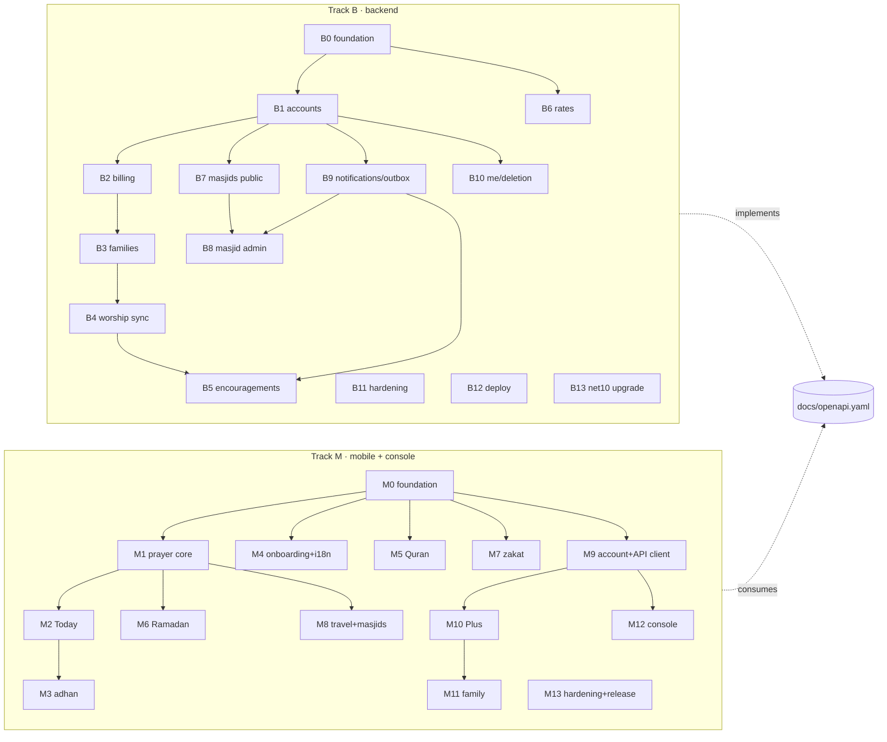

# Sakina: Implementation Plan (MVP)

| | |
|---|---|
| Status | Ready for build |
| Date | 2026-10-17 |
| Launch | Ramadan 1448 (expected about 8 Feb 2027). **Code freeze 11 Jan 2027**, store submission 18 Jan 2027 |
| Inputs | `SPEC.md` (story IDs), `openapi.yaml` (operationIds), `ARCHITECTURE.md`, `adr/` |

## 0. How to use this plan

- There are two tracks, **B (backend)** and **M (mobile + console)**. They **share nothing but `docs/openapi.yaml`**. Neither track waits for the other: mobile builds against a Prism mock until the real API is available on staging. They meet at checkpoints C1–C4 for joint end-to-end tests.
- Every task is a TDD increment (CONTRIBUTING §2): **write the failing tests listed in "Tests first", then make them pass**. A task is done when its acceptance criteria (AC) hold, CI is green, and the PR links the task ID.
- Sizes: **S** = 1–2 files plus tests (≤ half a day), **M** = 3–5 files (≤ 1 day). Anything bigger is split. IDs are stable; append new tasks rather than renumbering.
- If the contract needs to change, stop and open an `api(contract)` PR (ADR-0011) before continuing.
- Branch names follow `feat/<ID>-slug`.

### Milestones and checkpoints

| Checkpoint | Target date | Backend ready | Mobile ready | Joint check |
|---|---|---|---|---|
| **C0 Foundations** | 2026-10-24 | B0 | M0 | Both CIs green on `main`; Prism mock serves the contract |
| **C1 Worship offline** | 2026-11-14 | B1, B6, B9 | M1–M5, M7 | Mobile worship works in airplane mode; staging API serves auth + rates; mobile signs in against staging |
| **C2 Family + Plus** | 2026-12-05 | B2–B5, B10 | M6, M9–M11 | Sandbox purchase → webhook → entitlement → create family → child link → log → grid on second device → encouragement push |
| **C3 Masjids** | 2026-12-19 | B7, B8 | M8, M12 | Console publishes iqamah → follower device gets push and sees times |
| **C4 Release candidate** | 2027-01-11 | B11–B13 | M13 | Full SPEC §8 success criteria; device matrix; proxy capture |

---

## Track B: Backend (ASP.NET Core 8, `apps/backend`)

> Environment note: the .NET SDK and NuGet were unavailable while planning. **B0 must be the first task**, and it is verified in GitHub Actions (`backend.yml`).

### B0: Foundation (C0)

**B0.1 Solution skeleton** (M)
- Create `Sakina.sln`, `global.json` (SDK `8.0.4xx`, `rollForward: latestFeature`), `Directory.Build.props` (Nullable, `TreatWarningsAsErrors`, `AnalysisLevel=latest-recommended`, `InvariantGlobalization=false`), `Directory.Packages.props` (central versions), and the four `src` and two `tests` projects with the references in ARCHITECTURE §4.1. Add `.config/dotnet-tools.json` with `dotnet-ef`.
- Tests first: `ArchitectureTests` (NetArchTest.Rules). Domain references nothing; Application doesn't reference Infrastructure or Api; Api controllers don't reference `DbContext`.
- AC: `make backend-build backend-lint backend-test` passes locally and in CI.

**B0.2 API host basics** (M) · `healthLive`
- `Program.cs` with Serilog (JSON console, scrubbing policy), ProblemDetails with the `code`/`traceId` extension, `ResultMapper`, `/health/live`, Swashbuckle (Development/Test only), `System.Text.Json` options (camelCase, string enums in UPPER_SNAKE, `UnmappedMemberHandling.Disallow`, a decimal-as-string converter), Kestrel body limit of 256 KB, and `ForwardedHeaders`.
- Tests first: `GET /health/live` → 200 `{status:"Healthy"}`; an unknown route → 404 problem+json with `code=NOT_FOUND`; a malformed JSON body → 422 `MALFORMED_JSON`; an unknown property → 422 `VALIDATION_FAILED`; decimals serialise as strings.
- AC: matches the `Problem` schema in openapi.yaml.

**B0.3 Persistence + Testcontainers fixture** (M)
- `SakinaDbContext` (snake_case naming, `citext`), first migration `Initial` (empty apart from extensions + `outbox_messages`), `PostgresContainerFixture` (`postgres:16-alpine`, migrations applied once per test run, Respawn for per-test reset), `SakinaApiFactory : WebApplicationFactory<Program>` with config overrides, and `/health/ready` with the Npgsql check (`healthReady`).
- Tests first: readiness is 200 with the DB up and 503 with it stopped; the migration applies cleanly; `has-pending-model-changes` is false (a CI step).
- AC: integration tests run in CI against Testcontainers (Docker is available on `ubuntu-latest`).

**B0.4 Contract test harness** (M)
- `OpenApiContractTests`: load `docs/openapi.yaml` (Microsoft.OpenApi.Readers) and the Swashbuckle document. Assert that **implemented (method, path) ⊆ contract** and that the documented statuses for implemented operations match. Add a test-only response-validation middleware that validates every JSON response in the integration suite against the contract schema for that operation and status (JsonSchema.Net). Add `AuthorizationMatrixTests` (anonymous call → 401 unless `security: []`).
- Unimplemented operations are listed in `ContractCoverage.Pending.txt`. That list must be empty at C4.
- AC: the harness fails when a controller adds an undocumented route or status.

### B1: Accounts (C1)

**B1.1 Register + login** (M) · SPEC AUTH-1, AUTH-2 · `register`, `login`
- Domain `User`, `PasswordHasher<User>` (600k iterations), the breached-password list (embedded resource, top 100k SHA-1 prefixes), FluentValidation.
- Tests first: 201 with the tokens + user shape; duplicate email (case and whitespace variants) → 409 `EMAIL_TAKEN`; weak password → 422 `PASSWORD_TOO_WEAK`; login with a wrong password and login with an unknown email return the same 401 `INVALID_CREDENTIALS`; the 6th failed login in 15 min → 429.

**B1.2 JWT issuing + validation** (S) · ADR-0008
- `JwtTokenIssuer`, JwtBearer config, `Caller` construction from claims, and an `OnChallenge` that writes problem+json with `TOKEN_EXPIRED` vs `UNAUTHENTICATED`.
- Tests first: an expired token → 401 `TOKEN_EXPIRED`; wrong audience, wrong key, or `alg=none` → 401; a `scope=child` token on a user-only endpoint → 403 `CHILD_SCOPE_NOT_ALLOWED`.

**B1.3 Refresh rotation + logout** (M) · AUTH-3, AUTH-5 · `refreshToken`, `logout`
- Tests first: refresh returns a new pair and the old token is rejected; reusing a consumed token → 401 `REFRESH_TOKEN_REUSED` and the sibling token from the same chain is also revoked; logout → 204 and refresh then fails; `allDevices` revokes every chain; the 180-day absolute expiry holds (fake clock).

**B1.4 Social sign-in** (M) · AUTH-4 · `socialSignIn`
- `GoogleTokenVerifier`, `AppleTokenVerifier` (JWKS cache via `IHttpClientFactory`, refresh on an unknown `kid`). Tests use a locally generated RSA key served by WireMock as a fake JWKS.
- Tests first: a valid Google token → 201 new / 200 existing; wrong `aud` or `iss`, or expired → 401 `SOCIAL_TOKEN_INVALID`; Apple nonce mismatch → 401; provider email equals an existing password account → 409 `ACCOUNT_EXISTS`.

**B1.5 Password reset** (S) · AUTH-6 · `forgotPassword`, `resetPassword`
- Tests first: 202 for both known and unknown emails (only the known one enqueues an email outbox row); reset works once; the second use or an expired token → 401 `RESET_TOKEN_INVALID`; all refresh tokens are revoked.

**B1.6 GET/PATCH /me** (S) · ME-1, ME-2 · `getMe`, `updateMe`
- Tests first: the shape matches `Me`; patching preferences merges; an invalid locale → 422; an empty body → 422.

**B1.7 Rate-limit policies** (S) · ARCHITECTURE §6.4
- Register every named policy, partition by user/IP, and write a 429 problem with `Retry-After`. Config allows tests to lower limits.
- Tests first: one test per policy at a tiny configured limit.

### B2: Billing (C2)

**B2.1 Entitlements model + GET** (S) · BILL-2 · `getMyEntitlements`
- Tests first: a new user → `{plus:{active:false,source:NONE}}`.

**B2.2 RevenueCat webhook** (M) · BILL-1 · `revenueCatWebhook`
- Constant-time secret comparison, persistence to `billing_events` (idempotent on `event.id`), an outbox message `RecomputeEntitlement`.
- Tests first: no secret or a wrong one → 401; a valid one → 200 with the row persisted; a duplicate → 200 with no second outbox row; a `TEST` event → 200 no-op; unknown fields are accepted.

**B2.3 Recompute from RevenueCat** (M) · BILL-1 AC3, `refreshMyEntitlements`
- `RevenueCatClient` (typed HttpClient, Polly retry) and `EntitlementRecomputer`. WireMock serves subscriber fixtures (active, trial, expired, grace, refunded).
- Tests first: each fixture maps to the right `Entitlements`; `TRANSFER` updates both users; refresh is rate-limited (7th/hour → 429); upstream down → 503 `UPSTREAM_UNAVAILABLE` while keeping the last state.

**B2.4 Family-derived entitlement + `PlusRequired` policy** (S) · PLUS-3
- `IEntitlementQuery.HasPlusAsync(caller)`, which is true via own purchase or the family owner's purchase. The `PlusRequired` authorisation handler reads `x-sakina-plus-required` operations.
- Tests first: a member of a Plus family → `source=FAMILY`; a Plus-required endpoint without Plus → 403 `PLUS_REQUIRED`; a matrix test over every operation with the extension.

### B3: Families (C2)

**B3.1 Create + get + mine** (M) · FAMAPI-1, FAMAPI-2 · `createFamily`, `getFamily`, `listMyFamilies`
- Domain `Family` aggregate (≤ 6 people, owner limits), `Families.VisibleTo(caller)` selector.
- Tests first: create → 201 OWNER; a second family → 409 `FAMILY_LIMIT_REACHED`; **cross-tenant GET → 404**; unit tests for the domain invariants.

**B3.2 Invites** (S) · FAMAPI-4 · `createFamilyInvite`, `listFamilyInvites`, `revokeFamilyInvite`
- Unambiguous 8-character codes stored hashed; a 7-day expiry.
- Tests first: the code is only in the create response; a MEMBER creating one → 403 `ROLE_REQUIRED`; revoke is idempotent.

**B3.3 Join** (S) · FAMAPI-5 · `joinFamily`
- Tests first: success → the family; expired, revoked and unknown codes all → 404 `INVITE_NOT_FOUND`; joining twice → 409 `ALREADY_MEMBER`; 7th person → 409 `FAMILY_FULL`; the 11th attempt within an hour → 429.

**B3.4 Members: update/remove, ownership transfer** (M) · FAMAPI-6 · `listFamilyMembers`, `updateFamilyMember`, `removeFamilyMember`
- Tests first: only the OWNER changes roles; setting OWNER transfers ownership (the old owner becomes GUARDIAN); a member toggles their own `shareWorship` but not someone else's (403); the OWNER leaving → 409 `OWNER_MUST_TRANSFER`.

**B3.5 Child profiles** (S) · FAMAPI-7 · `createChildProfile`, `updateChildProfile`, `deleteChildProfile`
- Tests first: a guardian creates one (`kind=CHILD`, `shareWorship=true`); a MEMBER → 403; the 7th person → 409; delete cascades to logs and progress.

**B3.6 Child link codes + child sessions** (M) · AUTH-7 · `createChildLinkCode`, `linkChildDevice`
- Tests first: the code works once; it expires after 10 min (fake clock); 6 attempts per IP → 429; the child token can read `families/mine` but gets 403 `CHILD_SCOPE_NOT_ALLOWED` on `getMe`; deleting the child revokes its sessions.

**B3.7 Read-only when the owner's Plus lapses** (S) · FAMAPI-8
- Tests first: owner entitlement inactive → `status=READ_ONLY`; writes → 403 `FAMILY_READ_ONLY`; reads are still OK; an archive job after 90 days (fake clock).

**B3.8 Rename/delete family** (S) · FAMAPI-3 · `updateFamily`, `deleteFamily`

### B4: Worship sync (C2)

**B4.1 Prayer log batch upsert** (M) · SYNC-1 · `upsertFamilyPrayerLogs`
- Raw-SQL upsert `ON CONFLICT … DO UPDATE … WHERE excluded.client_updated_at > prayer_logs.client_updated_at`. `status:null` deletes but keeps a tombstone (`status` NULL row) for `updatedSince` pulls.
- Tests first: insert → `applied=true`; an older write → `applied=false` with `current`; null clears; a non-sharing member → 403 `NOT_SHARING`; a child token can write only its own child (other member → 404); a guardian writes for a child profile; a date more than a day ahead → 422 with the `entries[i].date` path; 201 entries → 422; the same `Idempotency-Key` replays the response.

**B4.2 Prayer log query** (S) · SYNC-2 · `listFamilyPrayerLogs`
- Tests first: a range > 62 days → 422; `memberId` filter; `updatedSince` returns tombstones; non-sharing members are excluded; cross-tenant → 404.

**B4.3 Family Quran progress** (S) · SYNC-3 · `getMemberQuranProgress`, `putMemberQuranProgress`

**B4.4 Personal Quran state with ETag** (M) · QSYNC-1 · `getMyQuranState`, `putMyQuranState`, `deleteMyQuranState`
- Tests first: first PUT without If-Match → 200 v1; a second PUT without If-Match → 428; stale If-Match → 412 with the current body; > 256 KB → 413; an invalid surah key → 422; without Plus → 403.

**B4.5 Zakat records** (M) · ZREC-1 · `listMyZakatRecords`, `createMyZakatRecord`, `getMyZakatRecord`, `replaceMyZakatRecord`, `deleteMyZakatRecord`, `deleteAllMyZakatRecords`
- Tests first: decimal round-trips exactly (`"1450000.0000"` in, `"1450000"` out, normalised); cross-user → 404; delete-all is idempotent.

### B5: Encouragements (C2)

**B5.1 Send + list + seen** (M) · ENC-1 · `sendEncouragement`, `listEncouragements`, `markEncouragementSeen`
- Writes an outbox `PushEncouragement` in the same transaction.
- Tests first: a guardian sends to a child → 201 + outbox row; a child token cannot send (403); preset XOR text (both or neither → 422); the 11th to the same recipient in a day → 409 `ENCOURAGEMENT_DAILY_LIMIT`; a child token lists only its own; seen is recipient-only.

**B5.2 Encouragement push handler** (S)
- Tests first (WireMock OneSignal): a data-only payload with `include_aliases.external_id=["child:<id>"]`, no `contents`; `idempotency_key` = the outbox ID; the recipient's preference `encouragements=false` → no call.

### B6: Rates (C1)

**B6.1 Provider port + refresher + cache** (M) · RATES-1 · `getMetalRates`, `listRateCurrencies`
- `IMetalRatesProvider` with a `FakeMetalRatesProvider` for dev/test and one real adapter behind config (the provider is decided later, SPEC §10 Q3). `RatesRefresher` runs every 15 min under an advisory lock.
- Tests first: values are decimal strings; an unsupported currency → 422 `UNSUPPORTED_CURRENCY`; upstream failing with a value < 72 h old → `isStale=true`; ≥ 72 h → 503 `RATES_UNAVAILABLE`; the `Cache-Control` header is present; the endpoint works anonymously.

### B7: Masjids, public (C3)

**B7.1 Masjid entity + search by cells/q** (M) · MASJIDAPI-1 · `searchMasjids`
- A `geohash4` column, indexed, computed in the domain from lat/lng.
- Tests first: 5-character cells → 422 `LOCATION_TOO_PRECISE`; 10 cells → 422; neither `cells` nor `q` → 422; only PUBLISHED masjids are returned; cursor pagination is stable; **a log-capture test shows that `cells` never appears in the logs**.

**B7.2 Detail, iqamah (ETag/304), announcements, public groups** (M) · MASJIDAPI-2 · `getMasjid`, `getMasjidIqamah`, `listMasjidAnnouncements`, `listPublicAudienceGroups`
- Tests first: PENDING → 404; group announcements are hidden from anonymous callers and non-group followers; `If-None-Match` → 304.

**B7.3 Follow/unfollow + my follows** (S) · MASJIDAPI-3 · `followMasjid`, `unfollowMasjid`, `listMyFollows`
- Tests first: idempotent PUT; groups from another masjid → 422; unfollowing a masjid not followed → 204.

### B8: Masjid admin (C3)

**B8.1 Register + admin list/get/patch + staff verify** (M) · ADMIN-2 · `registerMasjid`, `listAdministeredMasjids`, `getAdministeredMasjid`, `updateAdministeredMasjid`, `verifyMasjid`
- `Masjids.AdministeredBy(caller, minRole)` selector.
- Tests first: register → PENDING + OWNER; a non-staff user calling verify → 403; an EDITOR patching → 403; cross-masjid → 404.

**B8.2 Iqamah draft + publish** (M) · ADMIN-3 · `getIqamahDraft`, `putIqamahDraft`, `publishIqamah`
- Tests first: the draft is seeded from the last published week; `changedSincePublished` counts are right; a stale If-Match → 412; publishing a stale version → 409 `DRAFT_VERSION_STALE`; publish is idempotent (no second outbox row); `notify=false` produces no push; `ADHAN_OFFSET` without `offsetMinutes` → 422.

**B8.3 Announcements + fan-out** (M) · ADMIN-4 · `postAnnouncement`, `listAdminAnnouncements`
- Tests first: the EVERYONE audience counts followers; GROUP counts that group; with 4,500 followers there are 3 outbox batch messages; the WireMock OneSignal request bodies are right; an EDITOR is allowed.

**B8.4 Audience groups** (S) · ADMIN-5 · `listAudienceGroups`, `createAudienceGroup`, `updateAudienceGroup`, `deleteAudienceGroup`

**B8.5 Funds + entries** (M) · ADMIN-6 · `listFunds`, `createFund`, `updateFund`, `deleteFund`, `listFundEntries`, `createFundEntry`
- Tests first: totals by month in the masjid's timezone; changing the currency after entries exist → 409 `FUND_HAS_ENTRIES`; an EDITOR → 403.

**B8.6 Rota shifts** (S) · ADMIN-7 · `listRotaShifts`, `createRotaShift`, `updateRotaShift`, `deleteRotaShift`
- Tests first: status is CONFIRMED when assignees ≥ needed; end time before start time → 422.

**B8.7 Roles + role invites** (M) · ADMIN-8 · `listMasjidRoles`, `updateMasjidRole`, `removeMasjidRole`, `createMasjidRoleInvite`, `acceptMasjidRoleInvite`
- Tests first: removing or demoting the last OWNER → 409 `LAST_OWNER`; only the OWNER manages roles.

**B8.8 Stats** (S) · CONSOLE-1 · `getMasjidStats`

### B9: Notifications and outbox (C1, used by B5/B8/B10)

**B9.1 Outbox table + dispatcher** (M) · ADR-0014
- Tests first: rows are claimed with SKIP LOCKED (two dispatchers never process the same row); backoff timing (fake clock); dead letter after 5 attempts; the `IOutboxDrainer` test hook; the readiness check fails when lag > 5 min.

**B9.2 OneSignal client** (S) · NOTIF-1, NOTIF-3
- Tests first (WireMock): headers `Authorization: Key …`, `include_aliases`, `target_channel`; 429/5xx → retry; 400 → dead letter; batches of at most 2,000 aliases.

**B9.3 Preferences gate + trial reminder job** (S) · NOTIF-2, BILL-3
- Tests first: prefs off → skipped; a trial expiring in 48 h ± 1 h → one push, never twice.

### B10: Account deletion and retention (C2)

**B10.1 DELETE /me** (M) · ME-3 · `deleteMe`
- Tests first: 202 with immediate token revocation; after the deletion job runs, no rows reference the user (an information-schema-driven assertion over every table with a `user_id` column); family ownership is transferred or the family is deleted; outbox messages for the OneSignal and RevenueCat cleanups; an audit row with a hashed ID only.

**B10.2 Diagnostics + retention job** (S) · DIAG-1 · `submitDiagnosticReport`
- Tests first: coordinate-like strings (`31.5204, 74.3587`, `lat`) → 422 `LOCATION_NOT_ALLOWED`; 4/day/IP → 429; deleted after 30 days (fake clock).

### B11: Hardening (C4)

**B11.1 Privacy log audit** (S): a test captures all log events across the full integration suite and asserts there are no emails, tokens, `cells` or bodies.
**B11.2 Contract coverage complete** (S): `ContractCoverage.Pending.txt` is empty.
**B11.3 Security review** (M): ASVS L2 checklist for auth/session; `dotnet list package --vulnerable` clean; `gitleaks` clean; dependency licences checked (FluentAssertions 7.x, no MediatR).
**B11.4 Load test** (S): k6 script, 50 RPS mixed reads/writes, p95 targets from SPEC §5.6, and 10k-follower fan-out under 2 min.

### B12: Deployment (C4)

**B12.1 Container image** (S): multi-stage Dockerfile, chiseled non-root runtime, `HEALTHCHECK`, and SBOM generation.
**B12.2 Migrations bundle + release workflow** (M): `release-backend.yml` (manual `workflow_dispatch`) builds the image and the `efbundle`, runs migrations against staging, deploys, and smoke-tests `/health/ready`. Rollback re-deploys the previous image (migrations must be backward-compatible for one release).
**B12.3 Staging environment** (S): needed by **C1**, so a minimal version (auth + rates) should be deployed early, around 2026-11-10.

### B13: .NET 10 upgrade (before C4, mandatory)

**B13.1** (S) Retarget to `net10.0`, bump the Microsoft.* / EF Core / Npgsql packages to 10.x, run the full CI, and write the superseding ADR. (.NET 8 support ends on 2026-11-10; ADR-0003.)

---

## Track M: Mobile + console (Flutter, `apps/mobile`)

> Environment note: the Flutter SDK and pub.dev were unavailable while planning. **M0 comes first** and is verified in GitHub Actions (`mobile.yml`).

### M0: Foundation (C0)

**M0.1 Project + lint + CI green** (M)
- `flutter create --org app.sakina --platforms ios,android,web --project-name sakina_mobile .`, `analysis_options.yaml` (flutter_lints plus strict casts/inference/raw-types, `prefer_relative_imports`, `always_use_package_imports: false`), directory layout per ARCHITECTURE §3.2, and a flavour/bootstrap with `ProviderScope`.
- Tests first: a smoke widget test that the app boots to a placeholder.
- AC: `make mobile-analyze mobile-test` is green in CI.

**M0.2 Design system** (M) · DESIGN_TOKENS.md
- `core/design/tokens.dart` (colours, spacing, radii, durations), `SakinaColors` and `SakinaType` ThemeExtensions, `ThemeData` light (sand) and night (teal) surfaces, bundled fonts (OFL licences in `assets/fonts/LICENSES`), script-aware text styles.
- Tests first: the token values equal DESIGN_TOKENS (a table-driven test); the contrast of each text/background pair used is ≥ 4.5:1 (computed in a test); goldens for a token sheet in EN and AR.

**M0.3 Routing + shell** (S)
- go_router with a bottom-nav `StatefulShellRoute` (Today, Quran, Family, More), plus redirects for onboarding-complete, auth-required and Plus-required (stubs).
- Tests first: an un-onboarded user is redirected to `/onboarding`; deep link `sakina://family/join?code=X` routes correctly.

**M0.4 Mock API + fixtures** (S)
- A `tool/mock_api.sh` running `npx @stoplight/prism-cli@5 mock ../../docs/openapi.yaml -p 4010`, and fixture JSON under `test/fixtures/api/` (one per response schema used).
- AC: `contract.yml` validates the fixtures against openapi.yaml.

**M0.5 Drift database + SQLCipher + outbox table** (M) · ADR-0013
- Tests first: the schema migration test (v1); the outbox enqueue coalesces by key; the "never-sync" tables have no outbox triggers.

**M0.6 l10n scaffolding** (S)
- ARB files for en/ur/ar, `gen-l10n`, the locale controller, and the RTL switch.
- Tests first: switching to `ar` sets `TextDirection.rtl`; a missing-key check script exits non-zero (wired into `mobile.yml`).

### M1: Prayer-time core, pure Dart (C1)

**M1.1 PrayerTimeCalculator wrapper** (M) · TODAY-2 AC4
- Wrap the `adhan` package. Value objects `PrayerTimeSettings` (method, madhab, high-latitude rule, adjustments).
- Tests first: a 30-city fixture (Lahore, Karachi, London, Birmingham, Oslo, Reykjavik, Toronto, NYC, Dubai, Riyadh, Jakarta, Istanbul, Cairo, Sydney, Cape Town, …) × the methods used there × 3 dates (including DST changes). Expected values come from praytimes.org / adhan-js reference runs, within ±1 min.

**M1.2 Method catalogue + country defaults** (S) · ONB-2 AC4, TRAVEL-1 AC2
- Tests first: PK → KARACHI + HANAFI; GB → MOONSIGHTING_COMMITTEE + STANDARD; an unknown country → MWL; every method has explanation copy keys.

**M1.3 Qibla + distance** (S) · TRAVEL-2
- Tests first: London → 119° ± 0.5°, about 4,790 km; Lahore → 258° ± 0.5°; the antipode edge case.

**M1.4 Hijri calendar** (S) · TODAY-1 AC1, RAM-1
- Umm al-Qura tables with a ±2 adjustment.
- Tests first: 17 Oct 2026 → 6 Jumada al-Ula 1448; the Ramadan 1448 start is within the expected range; the adjustment shifts correctly.

**M1.5 Offline city database** (M) · ONB-2 AC2/AC3
- `assets/cities/cities.sqlite` built by `tool/build_cities.dart` from GeoNames cities15000 (CC-BY: attribution in About). Nearest-city lookup (bounding box + haversine) and diacritic-insensitive multilingual prefix search.
- Tests first: the nearest city to known coordinates; "lahore", "لاہور" and "لاهور" all find Lahore; the search completes in under 50 ms on 150k rows (benchmark test).

**M1.6 Streak policy** (S) · TODAY-3 AC3
- Tests first: the streak rests on an unlogged day and never resets; LATE breaks the "on time" count but doesn't reset it.

### M2: Today (C1)

**M2.1 Today controller + next-prayer countdown** (M) · TODAY-1
- Tests first (fake clock): after Isha the next prayer is tomorrow's Fajr; the countdown text format; the widget test runs with no network providers.

**M2.2 Today screen UI** (M) · TODAY-1, TODAY-2, TODAY-5
- Tests first: six rows with Arabic names; the next row is highlighted; Sunrise can't be logged; the method label opens the "why" sheet; goldens EN/AR; text scale 2.0 without overflow.

**M2.3 Self prayer log + streak card** (S) · TODAY-3
- Tests first: logging updates the row and the streak; the outbox is enqueued only when a family has sharing on.

**M2.4 City chips** (S) · TODAY-4

### M3: Adhan (C1)

**M3.1 AdhanScheduler (pure)** (M) · ADHAN-4
- Tests first: 35 alarms for 7 days on Android and ≤ 64 on iOS; per-prayer modes; DST transitions for Europe/London (25 Oct 2026, 28 Mar 2027); a city change replaces the whole schedule.

**M3.2 Android alarm channel + reschedule receivers** (M)
- Kotlin: exact alarms, `BOOT_COMPLETED`/`TIME_SET`/`TIMEZONE_CHANGED`/`MY_PACKAGE_REPLACED`, per-voice channels with alarm audio attributes, and a delivery timestamp.
- Tests first: Dart-side tests with a fake channel; an instrumented Android test (`integration_test`) scheduling a 5 s alarm.

**M3.3 iOS notifications** (S): the 64-notification window, refreshed on open and in background app refresh.

**M3.4 PlatformHealthProbe + Adhan Health screen** (M) · ADHAN-1
- Tests first: every combination of probe states maps to the right pass count and copy; resuming the app re-runs the checks; the Fix button calls the right intent per OEM (fake).

**M3.5 Voices + preview + test adhan** (S) · ADHAN-2, ADHAN-3
- Tests first: the test adhan goes through the same scheduler path; "Last delivered" copy on Android vs iOS.

### M4: Onboarding + i18n (C1)

**M4.1 Onboarding flow** (M) · ONB-1, ONB-2, ONB-3
- Tests first: a network mock asserts **zero calls** during onboarding; method radio semantics; choosing ur/ar flips RTL immediately; completion persists and onboarding is skipped on the next launch.

**M4.2 Translate all strings to UR and AR** (S): there are no hard-coded strings (custom lint, or a test that scans the widget tree for `Text` widgets built with literals).

### M5: Quran (C1)

**M5.1 Bundled text DB + reader** (M) · QURAN-1
- Tests first: 114 surahs and 6,236 ayat present; Arabic-Indic digits in AR; text scale 2.0 without clipping (golden).

**M5.2 Translations + packs** (M) · QURAN-2
- Bundled EN; downloadable UR from the CDN with checksum verification.
- Tests first: the toggle persists; Urdu uses Nastaliq with line height ≥ 2.2; a corrupted pack is rejected.

**M5.3 Audio** (M) · QURAN-3
- Tests first: the playlist follows ayat; the highlight follows playback; **an entitlement guard test shows that no Quran route reads `plus`**.

**M5.4 Bookmarks + last read** (S) · QURAN-4
**M5.5 Memorise mode** (M) · QURAN-5

### M6: Ramadan (C2)

**M6.1 Ramadan controller + screen** (M) · RAM-1, RAM-3
- Tests first: auto-on window; suhoor = Fajr minus the precaution; difference from yesterday; Khatam distribution to night 27.

**M6.2 Fasting log (local only)** (S) · RAM-2
- Tests first: the table has no outbox hook (D-10); the summary counts are right.

### M7: Zakat (C1)

**M7.1 ZakatCalculator (pure, decimal)** (S) · ZAKAT-1 AC3/AC4
- Tests first: tola ↔ gram; silver nisab 612.36 g and gold 87.48 g; below nisab → 0; reproduces the design example exactly (net Rs 3,180,000 → Rs 79,500).

**M7.2 Rates repository** (S) · ZAKAT-1 AC2 · `getMetalRates`, `listRateCurrencies`
- Tests first (mock adapter): stale label; offline uses the cache; none at all → manual entry.

**M7.3 Zakat screens + local yearly record** (M) · ZAKAT-1, ZAKAT-2 AC1
**M7.4 Zakat backup (Plus)** (S) · ZAKAT-2 AC2 · `listMyZakatRecords`, `createMyZakatRecord`, `getMyZakatRecord`, `replaceMyZakatRecord`, `deleteMyZakatRecord`, `deleteAllMyZakatRecords`

### M8: Travel + masjids (C3)

**M8.1 Arrival detection** (S) · TRAVEL-1
- Tests first: > 50 km or a different timezone → card; "Keep Hanafi Asr" persists the madhab; no background location API is referenced (static test on the manifest and Info.plist).

**M8.2 Qibla compass** (S) · TRAVEL-2
**M8.3 Masjid search by geohash-4** (M) · TRAVEL-3, MASJID-1 · `searchMasjids`
- Tests first: **the request URL contains only 4-character cells and never lat/lng** (a Dio interceptor assertion); distance sorting is done on device.

**M8.4 Masjid detail + follow + groups** (M) · MASJID-1, MASJID-2 · `getMasjid`, `getMasjidIqamah`, `listMasjidAnnouncements`, `followMasjid`, `unfollowMasjid`, `listMyFollows`, `listPublicAudienceGroups`
**M8.5 Iqamah line on Today** (S) · MASJID-2 AC3

### M9: Account + API client (C1/C2)

**M9.1 Dio client, auth interceptor, ProblemDetails mapping, pinning** (M) · `refreshToken`
- Tests first: a single-flight refresh on `TOKEN_EXPIRED` (concurrent requests trigger one refresh); `REFRESH_TOKEN_REUSED` signs out; every problem `code` maps to a localised message; certificate pinning rejects a wrong key.

**M9.2 Sign in/up: email, Google, Apple; sign out; password reset; profile** (M) · SET-1 · `register`, `login`, `socialSignIn`, `logout`, `forgotPassword`, `resetPassword`, `getMe`, `updateMe`
- Tests first: the Apple nonce flow (raw nonce sent, hashed nonce passed to the SDK); `ACCOUNT_EXISTS` copy.

**M9.3 Sync engine** (M) · ARCHITECTURE §3.4 · drives `getMyQuranState`, `putMyQuranState`, `deleteMyQuranState` (Plus sync of M5.4)
- Tests first: backoff schedule; coalescing; a permanent 4xx dead-letters; the pull merges by LWW; the Quran-state 412 merge.

**M9.4 Settings: privacy screen, delete account, diagnostics** (M) · SET-1, SET-4, SET-5 · `deleteMe`, `submitDiagnosticReport`
- Tests first: the diagnostic preview contains no coordinates or city name; delete is a two-step flow.

**M9.5 OneSignal wrapper** (S) · ADR-0005
- Tests first: `login(externalId)` on sign-in; location sharing off; no tags API used (a static test).

### M10: Plus (C2)

**M10.1 RevenueCat wrapper + paywall** (M) · PLUS-1, PLUS-2 · `getMyEntitlements`, `refreshMyEntitlements`
- Tests first: offerings render store prices; the CTA copy for yearly and monthly; purchase requires sign-in; refresh after purchase; the paywall is shown unprompted at most once per 30 days; "coming soon" badges.

### M11: Family (C2)

**M11.1 Family repository + sync wiring** (M) · `createFamily`, `listMyFamilies`, `getFamily`, `listFamilyMembers`
**M11.2 Family dashboard UI (grid, Quran journey)** (M) · FAM-5, FAM-7 · `getMemberQuranProgress`, `putMemberQuranProgress`
- Tests first: "{n} of 35"; no "missed" state exists; the screen-reader summary label; goldens.

**M11.3 Manage family: children, invites, join, leave/remove, rename/delete** (M) · FAM-1–FAM-3 · `createChildProfile`, `updateChildProfile`, `deleteChildProfile`, `createFamilyInvite`, `listFamilyInvites`, `revokeFamilyInvite`, `joinFamily`, `removeFamilyMember`, `updateFamily`, `deleteFamily`
**M11.4 Child device link mode** (M) · FAM-4 · `createChildLinkCode`, `linkChildDevice`
- Tests first: a child session sees only the child-allowed screens (Today, Quran, encouragements).

**M11.5 Encouragements send + receive-after-Maghrib** (M) · FAM-8 · `sendEncouragement`, `listEncouragements`, `markEncouragementSeen`
- Tests first (fake clock): a push received before Maghrib → a local notification scheduled at Maghrib; received after Maghrib and before Isha → shown now; received after Isha → next Maghrib.

**M11.6 Prayer log sharing toggle + sync** (S) · FAM-6 · `upsertFamilyPrayerLogs`, `listFamilyPrayerLogs`, `updateFamilyMember`

### M12: Masjid console, Flutter web (C3)

**M12.1 Console entrypoint, auth, masjid picker, masjid profile** (M) · CONSOLE-1 · `listAdministeredMasjids`, `getAdministeredMasjid`, `updateAdministeredMasjid`, `getMasjidStats`
**M12.2 Iqamah timetable editor + publish** (M) · CONSOLE-2 · `getIqamahDraft`, `putIqamahDraft`, `publishIqamah`
- Tests first: draft change count; adhan times computed in the browser; publish label states.

**M12.3 Announcements + audience groups** (M) · CONSOLE-3 · `postAnnouncement`, `listAdminAnnouncements`, `listAudienceGroups`, `createAudienceGroup`, `updateAudienceGroup`, `deleteAudienceGroup`
**M12.4 (stretch) Funds + rota UI** (M) · CONSOLE-4, CONSOLE-5 · `listFunds`, `createFund`, `updateFund`, `deleteFund`, `listFundEntries`, `createFundEntry`, `listRotaShifts`, `createRotaShift`, `updateRotaShift`, `deleteRotaShift`
**M12.5 Register masjid + roles** (M) · `registerMasjid`, `listMasjidRoles`, `updateMasjidRole`, `removeMasjidRole`, `createMasjidRoleInvite`, `acceptMasjidRoleInvite`. Not consumed by any client: `revenueCatWebhook` (RevenueCat → server), `verifyMasjid` (staff tool, done by curl at MVP), `healthLive`/`healthReady` (platform probes)

### M13: Hardening + release (C4)

**M13.1 Accessibility pass** (M): TalkBack/VoiceOver in EN and AR; text scale 2.0; 48 dp targets (an automated `meetsGuideline` test on each screen).
**M13.2 Privacy release checks** (S): a deny-list scan of `pubspec.lock`; a merged-manifest `AD_ID` removal check; mitmproxy capture for onboarding, Today, Travel and Family.
**M13.3 Device matrix run** (S) · SPEC §7.6.
**M13.4 Store readiness** (M): the Play exact-alarm declaration, privacy nutrition labels / Data safety form (from SPEC §6.2), screenshots in EN/UR/AR.
**M13.5 Landing page** (M) · LAND-1: static site (outside the Flutter app, `apps/landing` if needed, with an ADR addendum), no third-party scripts.

---

## Risks and mitigations

| Risk | Impact | Mitigation |
|---|---|---|
| Google Play rejects the exact-alarm permission (`USE_EXACT_ALARM`) | High | Declare it as alarm-clock functionality early (M13.4 started at C1). Fallback: `SCHEDULE_EXACT_ALARM` with the user grant from the Adhan Health check |
| OEM battery killers (Xiaomi, Oppo) still drop alarms | High | OEM-specific deep links; the device matrix; the "test adhan" feature; dontkillmyapp.com guidance |
| .NET 8 end of support (10 Nov 2026) before launch | Medium | B13 mandatory; recommendation to start on net10.0 |
| Quran translation and audio licensing not resolved | High | SPEC §10 Q2. Bundle only public-domain or explicitly licensed text. M5 uses placeholders until cleared |
| Scholar sign-off delays method and zakat copy | Medium | Copy lives behind l10n keys and can change without code; ask early |
| Prayer-time inaccuracy at high latitudes | Medium | Explicit high-latitude rules, Moonsighting Committee for the UK, user adjustments, test vectors |
| Metals rate provider cost or terms | Low | Port + fake provider; manual entry fallback in the app |
| Flutter web console accessibility | Medium | Semantics enabled; screen-reader test at C3; ADR-0002 exit path |
| Builders cannot run SDKs locally (planning environment) | Medium | CI-first verification; B0/M0 get CI green before features |
| Rate limits are per instance only | Low | Acceptable at 1–2 instances; revisit with Redis/Postgres limiter |

## Open questions
See SPEC §10. None of them block B0–B6 or M0–M7.
